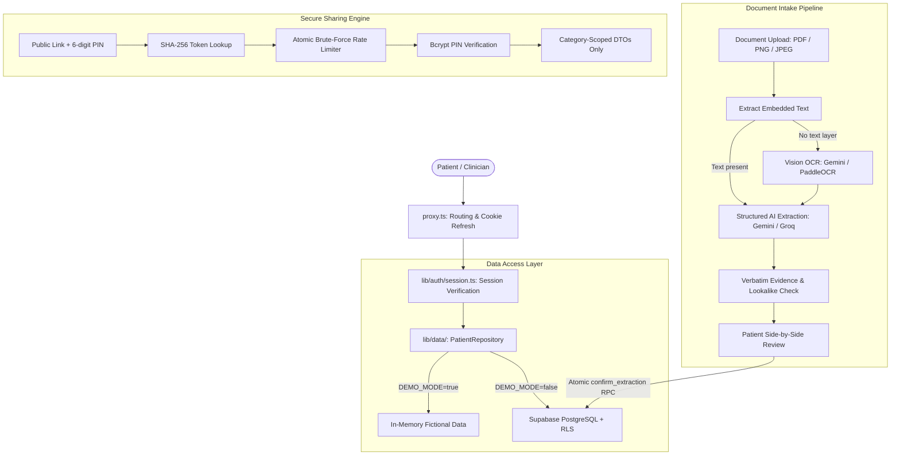

<div align="center">

# MediLink

**The patient-controlled, privacy-first health record vault.**

Turn fragmented prescriptions, lab reports, and clinical documents into a unified, permanent, reviewable timeline that you own and control.

[](https://nextjs.org/)
[](https://react.dev/)
[](https://www.typescriptlang.org/)
[](https://tailwindcss.com/)
[](https://supabase.com/)
[-fcc72b?style=flat&logo=vitest)](https://vitest.dev/)
[](LICENSE)

[Getting Started](#getting-started) • [Key Features](#key-features) • [Architecture](#architecture) • [Testing](#testing--quality-gates) • [Documentation](#documentation--support) • [Contributing](#contributing)

</div>

---

## What MediLink Does

Healthcare records today are deeply fragmented. Every visit to a new clinic, diagnostic laboratory, or specialist forces patients to start their medical story from scratch. Paper prescriptions are stored in folders, lab PDFs are lost in email threads, and critical medical histories are forgotten during emergencies.

**MediLink** solves this problem by giving patients a single, secure vault where all medical documents are consolidated, digitized, and structured into a continuous chronological history.

> [!IMPORTANT]
> **Clinical Safety Boundary**: MediLink is strictly an organization and access tool. It does **not** diagnose conditions, prescribe medications, interpret laboratory values, or provide automated clinical recommendations. Extracted alerts (such as duplicate medications or repeat tests) are rule-based heuristics meant solely for discussion with a licensed healthcare professional.

---

## Key Features

- **Unified Medical Timeline & Record Vault**
  - Consolidates prescriptions, lab reports, discharge summaries, and vaccine certificates into an interactive, chronological timeline.
  - Dedicated views for medications, lab results, diagnoses, and allergies.
  - Timeline filtering by category, date range, and prescriber.

- **Privacy-Preserving Intake Pipeline**
  - **Embedded text extraction** for digital PDFs directly in-browser/server without external API calls.
  - **Vision OCR fallback** (Google Gemini Vision or self-hosted PaddleOCR) for scanned images and photos.
  - **Structured AI extraction** (Gemini 2.5 Flash with Groq fallback) targeting strict JSON schemas.
  - **Verbatim evidence validation**: Every extracted medication, dose, condition, and lab value must quote the source text verbatim. Discrepancies and ambiguous date formats (e.g., `09/10` vs `10/09`) are automatically flagged.

- **Human-in-the-Loop Review Gate**
  - Nothing enters a patient's permanent record automatically.
  - Extracted records are reviewed side-by-side with the original scanned document.
  - **Handwriting safety safeguards**: Flagged entries (uncertain AI extractions, look-alike medicine names from 21 confusable drug families, or `[illegible]` marks) require an explicit patient confirmation before commit.

- **Zero-Knowledge Clinician Sharing**
  - Generate time-limited sharing links (24 hours to 90 days) protected by 256-bit cryptographically random tokens and 6-digit bcrypt-hashed PINs.
  - **Granular scoping**: Patients choose exactly which record categories to share (allergies, medications, lab results, conditions, or timeline).
  - **Atomic PIN brute-force defense**: Guesses are reserved atomically before checking (max 5 attempts per 15 minutes, 20 total per link before permanent lockout).
  - One-click immediate revocation.

- **Emergency Access QR Card**
  - Opt-in emergency profile displaying only life-critical data (blood group, emergency contact, severe allergies, active conditions, and selected medications).
  - Cryptographically derived, reprintable emergency QR code that can be deactivated or regenerated at any time.

- **Comprehensive Audit & Access Logging**
  - Complete, tamper-evident audit history of all account modifications.
  - Real-time logging of clinician link views and PIN attempts with keyed cryptographic IP hashing.

- **Dual-Mode Operation**
  - **Demo Mode**: Instant zero-setup evaluation with fictional patient data (Ananya Rao). Operates completely in-memory with zero external credentials.
  - **Real-User Mode**: Enterprise-grade multi-tenant architecture with Supabase Auth, PostgreSQL Row Level Security (RLS), and private encrypted object storage.

---

## Architecture

MediLink is built on a least-privilege, defense-in-depth architecture where security boundaries are enforced at the database and server levels:



### Technology Stack

| Layer | Technology | Details |
|---|---|---|
| **Framework** | [Next.js 16.4](https://nextjs.org/) | App Router, Server Actions, Partial Prerendering, `proxy.ts` routing |
| **Frontend** | [React 19.3](https://react.dev/) + [TypeScript 5](https://www.typescriptlang.org/) | Modern React compiler conventions, strict types |
| **Styling** | [Tailwind CSS v4](https://tailwindcss.com/) | Custom design tokens, glassmorphism, fluid responsive layouts |
| **Components** | `@base-ui/react` + [Lucide Icons](https://lucide.dev/) | Unstyled, accessible UI primitives |
| **Database & Auth** | [Supabase](https://supabase.com/) | PostgreSQL, Row Level Security (RLS), GoTrue Auth, Private Storage |
| **AI Extraction** | Google Gemini 2.5 Flash / Groq | Multimodal vision, structured JSON extraction schema, Groq emergency backup |
| **OCR** | Gemini Vision / PaddleOCR | Server-side text detection and OCR FastAPI microservice in [services/ocr](services/ocr) |
| **Testing** | [Vitest](https://vitest.dev/) + [@electric-sql/pglite](https://pglite.dev/) | 380+ tests; real migrations tested locally against PGlite |

---

## Getting Started

### Prerequisites

- **Node.js**: `v22.0.0` or higher (Node 24 recommended)
- **npm**: `v10.0.0` or higher
- *(Optional for local database)*: Docker Desktop if running a local Supabase stack

### 1. Clone & Install

```bash
git clone https://github.com/venuvivek-byte/MediLink.git
cd MediLink
npm install
```

### 2. Configure Environment

Copy the example configuration file:

```bash
cp .env.example .env.local
```

Configuration is strictly validated on application startup via Zod in `lib/config/schema.ts`. Missing or misconfigured variables will halt startup with an informative message.

#### Mode A: Demo Mode (Instant Setup — No Accounts Needed)
Leave default settings in `.env.local`:
```env
DEMO_MODE=true
NEXT_PUBLIC_APP_URL=http://localhost:3000
```
No Supabase or AI credentials are required.

#### Mode B: Real-User Mode (Production & Cloud Connected)
Set `DEMO_MODE=false`, supply your Supabase credentials, and generate a 32+ character `SESSION_SECRET`:
```bash
# Generate a cryptographically secure session secret
node -e "console.log(require('crypto').randomBytes(32).toString('base64url'))"
```

Update your `.env.local`:
```env
DEMO_MODE=false
NEXT_PUBLIC_APP_URL=http://localhost:3000
SESSION_SECRET=<generated_secret>

NEXT_PUBLIC_SUPABASE_URL=https://<your-project>.supabase.co
NEXT_PUBLIC_SUPABASE_ANON_KEY=<your-anon-key>
SUPABASE_SERVICE_ROLE_KEY=<your-service-role-key>

AI_PROVIDER=gemini
GEMINI_API_KEY=<your-gemini-key>
GEMINI_MODEL=gemini-2.5-flash
```

### 3. Database Setup (Real-User Mode)

MediLink includes the Supabase CLI as a project dependency:

#### Option 1: Remote Supabase Project (Recommended)
```bash
# Link to your Supabase project
npm run supabase -- link --project-ref <your-project-ref>

# Apply database migrations (001 through 008)
npm run db:push

# Generate TypeScript database types
npm run db:gen-types:linked
```

#### Option 2: Local Supabase Stack via Docker
```bash
# Start local Supabase containers
npm run supabase -- start

# Apply migrations and seed data
npm run db:reset

# Generate TypeScript types from local instance
npm run db:gen-types
```

### 4. Start Development Server

```bash
npm run dev
```

Visit [http://localhost:3000](http://localhost:3000) in your browser.

#### Demo Credentials:
- Click **"Continue as demo patient"** to sign in as fictional patient *Ananya Rao*.
- Clinician Share demo link: `http://localhost:3000/share/demo-clinician-share-token` (PIN: `482910`).
- Emergency Card demo link: `http://localhost:3000/emergency/demo-emergency-token`.

---

## Testing & Quality Gates

MediLink maintains rigorous test coverage spanning unit tests, API route tests, cryptographic token validations, and database Row Level Security tests run against local PGlite.

Run the test suite:
```bash
npm test
```

Run all validation checks (typecheck, lint, test, build):
```bash
npm run check
```

### Available NPM Scripts

| Script | Purpose |
|---|---|
| `npm run dev` | Starts the Next.js local development server |
| `npm run build` | Compiles production Next.js application bundle |
| `npm run start` | Starts production server |
| `npm run typecheck` | Validates TypeScript types across the entire codebase (`tsc --noEmit`) |
| `npm run lint` | Runs ESLint analysis |
| `npm test` | Runs the Vitest test suite |
| `npm run test:watch` | Runs Vitest in interactive watch mode |
| `npm run check` | Executes all quality gates in order (`typecheck` → `lint` → `test` → `build`) |
| `npm run db:push` | Pushes pending SQL migrations to the linked Supabase database |
| `npm run db:reset` | Resets local database and applies all migrations from scratch |

---

## Documentation & Support

Additional guides and architecture references are available in the repository:

- **[Project Handoff & Architecture Notes](docs/HANDOFF.md)**: Deep dive into design phases, security invariants, data schemas, and technical tradeoffs.
- **[Production Deployment Guide](docs/DEPLOYMENT.md)**: Detailed steps for deploying MediLink to Vercel with production environment variables.
- **[Next.js Development Rules](AGENTS.md)**: Guidelines and best practices for Next.js App Router conventions.
- **[Contributing Guidelines](CONTRIBUTING.md)**: Standards, branch workflows, and PR checklist.

### Getting Help

- **Issues & Discussions**: Report bugs or discuss features via [GitHub Issues](https://github.com/venuvivek-byte/MediLink/issues).
- **Security Inquiries**: For responsible disclosure of security vulnerabilities, please contact the maintainers directly.

---

## Maintainers

MediLink is actively maintained by:

- **Venu Vivek** ([@venuvivek-byte](https://github.com/venuvivek-byte))
- **Kontham Sripadha** ([@sripadhkontham16](https://github.com/sripadhkontham16))

---

## License

This project is licensed under the terms of the [MIT License](LICENSE).
